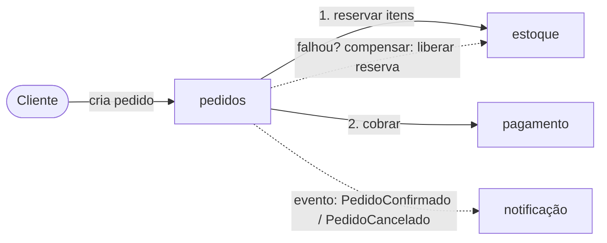

# ADR 0001 — Limites entre os serviços

- **Status:** Aceito
- **Data:** 2026-11-20

## Contexto

O Microservices Lab é um mini e-commerce feito para estudar sistemas distribuídos
(sagas, eventos, circuit breaker, observabilidade, service mesh).

Precisamos decidir **onde cortar** o sistema em serviços. Um corte ruim cria
serviços que precisam conversar o tempo todo, mudam sempre juntos e dividem dados.
Isso dá todos os custos de um sistema distribuído e nenhum benefício. É o
famoso "monolito distribuído".

Para cortar, usamos a ideia de **bounded context** do DDD: uma parte do negócio
com linguagem, regras e dados próprios. Dentro dele, uma palavra tem um único
significado. Fora dele, a mesma palavra pode significar outra coisa.

> **Nota honesta:** num produto real deste tamanho, um **monolito modular**
> (um deploy só, com módulos bem separados) seria a escolha certa. Aqui o objetivo
> é estudar os problemas que só aparecem quando existe rede no meio.

## Decisão

Quatro serviços, um por bounded context. **Cada serviço é dono dos seus dados.**

| Serviço | Stack | É dono de | Não sabe nada sobre |
|---|---|---|---|
| **pedidos** | NestJS | Pedido, itens, status do pedido, o fluxo da compra (saga) | Como cobrar, quanto tem em estoque |
| **pagamento** | NestJS | Cobranças, tentativas, estornos, conversa com o gateway (fake) | Itens do pedido, estoque |
| **estoque** | Go | Produtos (SKU, nome, preço), quantidade, reservas | Pagamento, cliente |
| **notificação** | Fastify | Mensagens enviadas, templates, histórico de envio | Regras de pedido, pagamento ou estoque |

### Por que esses cortes

- **pagamento** separado de **pedidos**: o gateway de pagamento é externo, lento e
  falha. É o lugar natural para estudar timeout, retry e circuit breaker sem que
  uma falha dele derrube a criação de pedidos.
- **estoque** separado: tem outro ritmo de acesso (muita leitura, reservas
  concorrentes) e outra regra de consistência (não pode vender o que não tem).
  Em Go, porque é o serviço mais "quente" e vai servir gRPC.
- **notificação** separado: é puramente **reativo**. Só escuta eventos
  (`PedidoConfirmado`, `PedidoCancelado`...) e nunca é chamado direto. Se ele cair,
  a compra continua funcionando.
- **pedidos** coordena: é o único que conhece o fluxo completo da compra.

### Regras de convivência

1. **Ninguém acessa o banco de outro serviço.** Só pela API (HTTP/gRPC) ou por eventos.
2. **Entre serviços, só IDs.** Ex: pagamento guarda `pedidoId`, sem foreign key
   entre bancos.
3. **Duplicar dado é permitido.** O pedido guarda uma *foto* do nome e do preço do
   produto no momento da compra. Se o preço mudar depois, o pedido antigo não muda.
4. **Consistência eventual entre serviços.** Uma compra passa por vários bancos,
   então não existe transação única. Usamos **saga com compensação** (Fase 2).

### Fluxo previsto da compra

Quais chamadas serão síncronas (gRPC/HTTP) e quais serão eventos (Kafka) fica
para a Fase 1, num ADR próprio.

### Fora do escopo (por enquanto)

- **Catálogo:** nome e preço ficam dentro de **estoque** para manter 4 serviços.
  Se o catálogo crescer (descrição, fotos, categorias), vira um serviço próprio.
- **Clientes e autenticação:** `clienteId` é só um texto. Sem login.

## Alternativas consideradas

- **Monolito modular.** Melhor para um produto real deste tamanho. Rejeitado só
  porque o objetivo do projeto é estudar sistemas distribuídos.
- **Cortar por entidade** (serviço de "produto", de "usuário", de "pedido-item").
  Rejeitado: vira CRUD com rede no meio, e qualquer regra de negócio precisa de
  vários serviços ao mesmo tempo.
- **Pagamento dentro de pedidos.** Rejeitado: a instabilidade do gateway contaminaria
  o fluxo de pedidos, e perderíamos o melhor lugar para estudar resiliência.
- **Banco compartilhado entre os serviços.** Rejeitado: cria acoplamento escondido.
  Mudar uma tabela quebraria outro serviço sem ninguém perceber.

## Consequências

**Boas**

- Cada serviço pode mudar, subir e cair sozinho. Já testado: com o banco do
  pagamento fora do ar, os outros três seguem saudáveis.
- Cada serviço escolhe sua stack (NestJS, Fastify, Go).
- Falhas ficam isoladas, e o lugar de cada padrão de resiliência fica claro.

**Ruins (e é isso que vamos estudar)**

- Sem transação única: precisamos de saga, outbox e idempotência.
- Dados duplicados e consistência eventual: por um tempo, os serviços podem discordar.
- Debugar fica mais difícil: precisamos de tracing distribuído (Fase 4).
- Mais coisas para operar: 4 apps + 4 bancos.

## Revisar quando

- Dois serviços começarem a mudar sempre juntos (sinal de corte errado).
- Um serviço precisar ler dados de outro em quase toda requisição.
- O catálogo crescer a ponto de pedir um serviço próprio.
